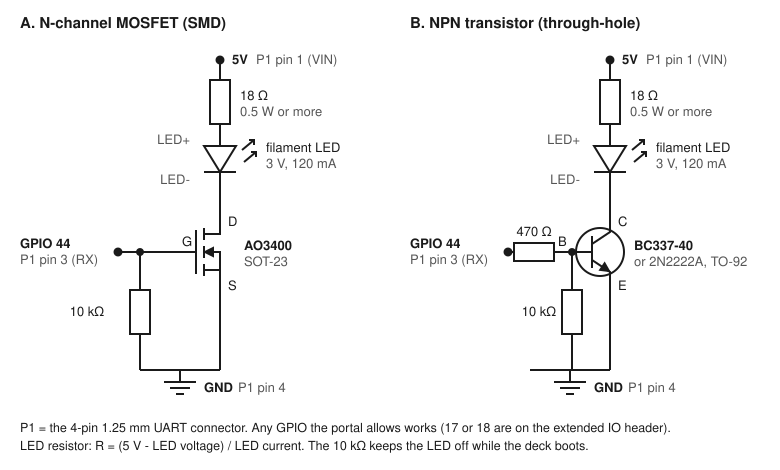

# tactula guide

> **Upstream credit:** tactula is based on [TouchDeck](https://github.com/Keralots/TouchDeck), created by [Rafał Stolarek (Keralots)](https://github.com/Keralots). Original software, documentation and underlying display work belong to the upstream project; see [LICENSE](LICENSE) for the retained MIT copyright notice.


Full reference for the deck's features. For initial installation, build the full image below (the upstream TouchDeck web flasher does not install tactula); for an overview, the [README](README.md).

- [Pages and tiles](#pages-and-tiles)
- [Web portal](#web-portal)
- [Home Assistant](#home-assistant)
- [Brand icons](#brand-icons)
- [Conditional tiles](#conditional-tiles)
- [Screen sleep](#screen-sleep)
- [Wallpapers and microSD](#wallpapers-and-microsd)
- [MQTT (Home Assistant discovery)](#mqtt-home-assistant-discovery)
- [HTTP buttons](#http-buttons)
- [HTTP sensors](#http-sensors)
- [Home Assistant media controls](#home-assistant-media-controls)
- [Status LED](#status-led)
- [Flashing without the web flasher](#flashing-without-the-web-flasher)
- [Building from source](#building-from-source)

## Pages and tiles

On a **new installation** with no saved `/deck.json`, tactula starts with one **Home** page containing a large standalone clock. The firmware no longer ships the original personalised bedroom, TV or fish-tank sample layout. This also applies to a fresh `with_bambu` build; Bambu connection settings are under **Configuration → Bambu printer** in the portal, visible only in `with_bambu` builds. Existing valid `/deck.json` layouts are loaded without being replaced. An ordinary firmware update **will not reset** your existing layout.

With `with_bambu`, enabling and saving a valid printer under **Configuration → Bambu printer** installs the original-inspired **P1S Printer** and **P1S AMS** page templates into the same internal `/deck.json` as your other pages (once, not on every reboot). The **P1S Printer** starter now follows Keralots' original three-row layout: a full-width job/progress header, four temperature cards (left/right nozzle, bed, chamber), then a two-column filament card, layer and light controls. On the single-nozzle P1S, the unavailable second nozzle is labelled accordingly; dual-nozzle hardware shows both. The additional AMS page remains stacked below. They appear in **Pages & tiles** and can be renamed, reordered, deleted, dragged/resized and mixed with other tiles; the Bambu widgets have a selector for print status, temperatures, filament, layer, chamber light, AMS status and slot colours. Saving edits persists them like any other page. Switching the printer off hides those saved pages on the touchscreen without deleting their layouts; switching it back on restores them. A deleted default page will **not** be recreated automatically, and printer credentials remain separately in NVS (never in `deck.json`).

### Internal flash storage

**Pages and tiles are saved to the ESP32's internal LittleFS flash partition** as `/deck.json`. No SD card is needed. tactula automatically mounts an existing filesystem. If the mount fails on a **completely erased, never-initialized flash partition**, it checks the entire partition for erased bytes (`0xFF`) and automatically creates/mounts LittleFS. Saving your first page therefore works without manual formatting.

If the partition is **not blank**, or a flash read fails, tactula will **never automatically format it**: this might be an older or recoverable filesystem. In that situation, go to **Maintenance → Internal flash storage** to diagnose the problem. If you are certain there is nothing on that partition you need to preserve, type **FORMAT INTERNAL FLASH** and explicitly initialize it. That action erases its existing files (`deck.json`, icon fonts and wallpapers) but does not intentionally clear the separate NVS Wi-Fi/Home Assistant credentials.

- **Grid:** up to 6x4 cells per page. Tiles are placed and sized in half-cell steps (1x1.5, 1.5x1, 0.5x0.5...); text and icons scale with the tile, so small tiles shrink instead of overlapping.
- **Columns:** pages stacked into a column. Swipe left and right between columns, up and down between the pages of a column.
- **Navigation tiles:** use **+ Add navigation** in Pages & tiles to create a dedicated icon-only button, then select its destination page. The icon (MDI or installed custom brand icon) is centred and scales with the tile; no label, state or Home Assistant entity is shown. Under the tile's More options use the explicit **Choose MDI / Brand icon** button to search the installed icons, or select an uploaded PNG (`*_off.png`) from **Maintenance → Custom PNG icons**. PNG takes priority while selected; choosing an icon switches the tile back to the icon display; the image is centred and uses the tile's full available area rather than reserving space for a label. The navigation button uses the existing page swipe/navigation action and can be resized like other tiles.
- **Home Assistant tiles:** live state over the WebSocket API, optimistic toggles, scenes / scripts / buttons, a detail card on long press with a level slider (light brightness, cover position, fan speed, volume, numbers). Icons come from Material Design Icons, the set Home Assistant uses (the font is installed from the portal).
- **Sensor history:** `style: "chart"` and `hours` (1..168, default 24) show Home Assistant history; the detail card includes min / max / now. Optional `warn` and `crit` thresholds colour the value and line amber or red; `crit` below `warn` makes lower values worse, such as battery levels. `"format": "duration"` shows a reading in s, min, h or d as `1h 49m` or `3d 2h` (uptime, a battery runtime).
- **Large temperature:** add with **+ Add temperature** and select a `sensor.*` **or** `climate.*` entity. Sensor tiles show the sensor's numeric state; climate tiles show its **current_temperature** (actual room temperature), **not** the thermostat target or HVAC mode. It displays a single large reading using the Clock tile's digit font (no chart) and a small label. By default it is standalone with no tile background; choose **Boxed** under More options to add the themed fill. Existing sensor tiles can select **Style → Large temperature**. When a large temperature tile is in the same row as a Clock tile, its value aligns with the clock's time by reserving a matching lower line for the sensor label (or a visually hidden spacer when the label is disabled). Without an adjacent clock, its normal centred layout is unchanged.
- **Weather:** add with **+ Add weather** and select any `weather.*` entity (for example Met Office or PirateWeather). Its current temperature, conditions and weather icon refresh from Home Assistant. With **Automatic** selected in the icon picker, the weather icon also follows `sun.sun` (above/below horizon): clear and partly-cloudy conditions switch between sun and moon versions at sunrise/sunset, even if the weather condition stays the same. A manually chosen MDI/brand icon remains fixed. If `sun.sun` is unavailable, TouchDeck uses the condition's regular icon. Tap to open a scrollable detail popup showing available feels-like temperature, humidity, wind/gusts, pressure, visibility and UV. Missing data is omitted. This shows **current observations only**; the separate Home Assistant `weather.get_forecasts` response is not yet included. Switch between weather providers via the tile's **Entity** selector. The tile can be Boxed or Standalone. On short 2×1 cards, the condition and icon share a compact top row so the temperature remains large and readable; taller cards show the title and condition separately. Readings are re-fitted whenever Home Assistant changes them.
- **Climate tiles:** a thermostat shows its mode and setpoint ("Heat 21.5°"). Tap toggles it; hold opens the card with - / + to move the setpoint in the entity's own step (0.5° when it reports none, within its min / max), the room temperature and what it is doing ("Now 20.5° • Heating"), and its HVAC modes as buttons. Taps in a row are sent as one `set_temperature` once they stop; a heat/cool range moves low and high together.
- **Slider tiles:** a light, cover, fan, media player or number as a tile that fills to its level; drag sideways on it to change the level (the page does not swipe there), tap to toggle, hold for the card. Pick "Slider" as the tile type in the portal.
- **Tile colours:** per tile, the accent, icon (off and on), text, off background and on fill colours, and in Glass its own glass and on opacity, all optional on top of the theme ("more options" in Pages & tiles).
- **Icon style:** buttons, switches, sliders and sensors show their icon in a circle or without one (then it fills its place). A switch can show a different icon while on. For Home Assistant lights, **Follow light colour** can use the light's live colour for the icon, tile background, both, or neither (fixed). The off state keeps its normal colours; colour temperature is supported too. The grid editor shows each tile's icon style and colour.
- **Quick panel:** pull down from the top edge for screen and LED brightness, link status, screen off, night mode, the top bar switch and the page editor. When a page contains a visible clock tile, the header's duplicate time is automatically hidden on that page; the page name and Wi-Fi remain, and the Wi-Fi moves to the right. Other pages retain their header clocks. Conditional clock tiles follow their current visibility.
- **Edit on the device:** long press an empty spot of a page (or Edit in the quick panel) to move (swap works as in the portal), resize or remove its tiles, or add one with + (a list of Home Assistant entities by group, from the list cached with "Update from HA" in the portal); Done saves the page.
- **System screens** for start-up, WiFi setup (with a QR code to join the setup network), connecting, and a firmware update screen with progress.

## Web portal

Open the device IP (or `http://<hostname>.local`) in a browser:

- **Overview:** live picture of the screen, Home Assistant link and device diagnostics.
- **Home Assistant:** connection address and token, connection status, plus optional MQTT discovery and broker settings.
- **Pages & tiles:** the icon font, pages (Duplicate copies one as a plain page), tiles, entity and icon pickers (None leaves a tile without an icon; a name of just a space leaves it without a name, `"label": ""`), columns, and a grid editor: drag tiles to move them (dropped onto another tile, that tile jumps to the dragged one's old place if it fits there), resize from the corner (half-cell steps), separately for landscape and portrait.
- **Display:** rotation, theme (Midnight, Daylight, or Glass: tinted glass tiles over a wallpaper), the Glass look and animations. In **Glass look**, **Wallpaper black overlay** (0–80%, 25% default on new installations) darkens both the sharp wallpaper and blurred glass beneath the tiles, leaving text/icons untouched. Its existing saved dimming setting is preserved during upgrades, so adjust the slider to taste. The overlay is pre-applied only when a wallpaper loads or its setting changes—no per-frame overlay or extra framebuffer.
- **Wallpapers:** pictures for the Glass theme and the photo frame: your own uploads, daily pictures the deck downloads from Windows Spotlight once a day, or both mixed. See [Wallpapers and microSD](#wallpapers-and-microsd).
- **Screen & light:** day brightness and the night schedule, screen sleep and presence, the status LED and its Home Assistant entity.
- **Time:** 12/24 h clock and timezone.
- **Network:** WiFi, hostname / mDNS, static IP.
- **Advanced:** configure MQTT discovery.
- **Maintenance:** microSD card, configuration backup (pages and settings; WiFi and the Home Assistant token are never included), firmware update, factory reset.

## Home Assistant

In **Home Assistant**, enter the Home Assistant address (for example `http://192.168.0.7:8123`) and a long-lived access token (HA profile, Security tab). The token is stored only on the device. Click **Save and connect** and check the status. Then open **Pages & tiles**, install the icon font, click "Update from HA" to cache the entity list, and add tiles from the entity picker.

## Brand icons

Optional [Custom Brand Icons by elax46](https://github.com/elax46/custom-brand-icons), available under the [MIT license](https://github.com/elax46/custom-brand-icons/blob/main/LICENSE), complement the MDI icon font. They require a mounted microSD card: enable **Maintenance > microSD card > Use the microSD card** first (the deck restarts). In **Pages & tiles > Icons > Brand icons**, install the latest GitHub release or upload a JavaScript file. New releases use a `custom-brand-icons.js` index and separate `cbi-N.js` chunks: **Install latest** downloads and combines all the chunks automatically. Uploading a matching `custom-brand-icons.js` index also downloads its chunks; for an offline subset upload one `cbi-N.js` chunk, or an older standalone `icons` file from the upstream Icon Finder. Chunk-index uploads need internet access to fetch their matching release. The browser converts and installs the set on the card under `/touchdeck/icons/`; no brand icons are bundled with the firmware. Use `phu:<name>` in tiles or Home Assistant entity icons, or select one in the portal's icon picker. **Browse & search** opens a visual catalogue of only the installed brand icons: search by name, click an icon to copy its `phu:` identifier, or use **Download names** to save a TXT list. The regular tile icon picker also searches brand icons and selects them directly. The gallery loads its names and font from the deck's microSD card; no second download is needed.

## Conditional tiles

In **Pages & tiles**, a tile's "more options" has "Show": Always, Only while the PC is on, Only while the PC is off, or Only while an entity is (or is not) in a state. A tile whose condition does not hold takes no cell, so a tile with the opposite condition can share it: volume buttons while the PC runs, a "PC power" switch in the same place while it is off. The page is laid out again when a condition changes (once nothing is being touched). When a page has conditional tiles, "Preview" above the grid switches each condition so you can place the tiles for both cases.

```json
{ "id": "vol", "type": "action", "when": "pc-on",
  "tap": { "action": "pc", "cmd": "volume_up" },
  "pos": { "landscape": { "x": 3, "y": 0 } } },
{ "id": "pcpow", "type": "toggle", "entity": "switch.pc_power",
  "when": { "entity": "switch.pc_power", "state": "!on" },
  "pos": { "landscape": { "x": 3, "y": 0 } } }
```

- `"pc-on"` / `"pc-off"` follow the tile's own PC (the PC of its command or metric, otherwise the first known PC). The PC counts as off about a minute after its companion stops sending, so a companion restart does not rearrange the page; it counts as on again with the first packet.
- `{ "entity": ..., "state": ... }` compares the state Home Assistant reports (`on`, `off`, `home`, `playing`...); a leading `!` means "is not". The tile stays hidden until Home Assistant has reported the entity; while Home Assistant is unreachable the last known state stands.

A whole page can follow a condition the same way ("Page shown" in the page settings; its PC is the first known one). With "Switch to it when it appears" (`"auto": true`) the deck slides to the page when the condition starts to hold, for example a PC stats page when the PC comes on, and back to the page shown before when it stops:

```json
{ "id": "pcstats", "name": "PC", "when": "pc-on", "auto": true, "tiles": [ ... ] }
```

A page that goes away while it is shown always hands over to another page first; a slide waits until nothing is being touched and no card is open.

## Screen sleep

On the **Screen & light** page, the Sleep card sets the time without touch and without presence after which the screen fades out or dims (the night level still applies when it is lower), and what counts as presence:

- Up to four Home Assistant entities (motion, occupancy, a person); one counts as present while its state is `on` or `home`. Optionally any PC sending metrics. Presence starting wakes the screen, also after Off in the quick panel.
- A touch always wakes it; that first touch does nothing else. With a night brightness of 0 a touch lights the screen at 10% until a minute after the last touch.
- **Night wake brightness** (off by default): during the night schedule, presence lights the screen at its own level, held for the sleep time after presence ends. Manual night from the quick panel is not affected. While it is lit this way, the quick panel's Screen slider sets the night wake level.

## Wallpapers and microSD

The **Wallpapers** page (used by the Glass theme and the photo frame) picks the pictures: My pictures (uploaded in the portal, cropped in the browser), Daily (Windows Spotlight, downloaded by the deck at a set hour) or Both. Internal storage fits a few dozen pictures, and Daily replaces its set every day.

With a microSD card in the slot, turn on **Maintenance > microSD card > Use the microSD card** (the deck restarts). It is off by default. Both galleries then live on the card under `/touchdeck/wall/` (`l`, `p` = own landscape / portrait, `dl`, `dp` = daily), Daily downloads up to 32 new pictures a day and keeps an archive (50 to 500 per orientation) from which the oldest are removed. Pinned pictures and the one on screen are never removed. The card must be FAT formatted; pictures already on internal storage stay there. The Display page shows how the card is connected: "SD 1-bit" is the normal mode, "SPI" is a slower fallback that a card left in from an older firmware uses until the deck is powered off and on.

The companion's **Wallpapers** page does this on the PC, much faster than on the deck: it downloads Spotlight pictures into the daily archive (microSD only), or crops a folder of your photos and sends them to My pictures, skipping pictures the deck already has. The folder itself is only read.

For scripts, `tools/wall_tool.py` (Python 3 + Pillow) does the same from the command line:

```
python tools/wall_tool.py prepare <photos> <out>              # your photos -> out/l, out/p
python tools/wall_tool.py spotlight 100 <out>                 # 100 Spotlight pictures -> out/dl
python tools/wall_tool.py upload <out> <deck-ip>              # out/l, out/p into My pictures
python tools/wall_tool.py upload <out> <deck-ip> --daily      # out/dl, out/dp into the daily archive
```

Or copy the folders straight onto the card under `/touchdeck/wall/` and restart the deck.

## MQTT (Home Assistant discovery)

Under **Home Assistant → Optional MQTT integration**, enable **Connect to an MQTT broker**, enter its host and port (plain TCP, default 1883), and optional username/password. Broker accepts `host`, `host:port` or `mqtt://host:port`. Leave the discovery prefix as `homeassistant` unless your MQTT integration uses another one. Save the form; its status line shows the connection. The deck appears under **Settings > Devices > MQTT** with the configured hostname. Home Assistant needs its MQTT integration and a broker such as the Mosquitto add-on.

- **Screen (light):** wake or turn off the display, and set the current day/night brightness.
- **Page (select):** choose a currently visible page; duplicate names get numbered suffixes.
- **Night (switch):** turn manual night mode on or off.
- **Touch (occupancy):** on for 60 seconds after the last touch.
- **Message ([MQTT notify](https://www.home-assistant.io/integrations/notify.mqtt/)):** wake and show a wrapped toast for 6 seconds, up to 200 bytes; punctuation is cleaned for the fonts.
- **LED (light):** control the day level; available only when the LED is enabled with a valid pin. Night and follow-display rules still apply.
- **RSSI (sensor):** WiFi signal strength in dBm, every 60 seconds.
- **IP (sensor):** the current IP address, updated on change.
- **Restart (button):** restart the deck after about half a second.

`<id>` is the last three bytes of the STA MAC, as six lowercase hex digits. Discovery lives at `<prefix>/<component>/touchdeck_<id>/<object>/config`; device states and commands use `touchdeck/<id>/<object>/state` and `touchdeck/<id>/<object>/set`. Availability is retained at `touchdeck/<id>/status` (`online` / `offline`). States and discovery are retained and replayed after reconnect or Home Assistant's `online` birth message. Commands should not be retained.

Example automation (replace the entity IDs with yours):

```yaml
alias: Wake the deck on motion
triggers:
  - trigger: state
    entity_id: binary_sensor.office_motion
    to: "on"
actions:
  - action: light.turn_on
    target:
      entity_id: light.touchdeck_screen
  - action: notify.send_message
    target:
      entity_id: notify.touchdeck_message
    data:
      message: "Welcome back"
```

A blank password keeps the saved one; **Clear password** removes it. Backups contain MQTT settings but never the password. Import preserves that password only when the broker host and username are unchanged; older backups leave MQTT off.

## HTTP buttons

A button tile can send an HTTP request instead of calling Home Assistant, for devices and services on the LAN that take commands over plain http (Tasmota, Node-RED, your own ESP projects). In **Pages & tiles**, use "+ Add HTTP button", or open a button's "more options" and set "On tap" to "HTTP request". Fill in the method, URL and optionally a body and headers; "Test" sends the request from the device and shows the answer. On the device a tap shows a short toast: "OK" for a 2xx answer, otherwise the status code or why it failed.

Example, toggling a Tasmota relay ([Tasmota docs](https://tasmota.github.io/docs/Commands/), spaces as `%20`):

```json
{ "id": "plug", "type": "action", "label": "Plug", "icon": "mdi:power",
  "confirm": "always",
  "tap": { "action": "http", "url": "http://192.168.0.50/cm?cmnd=Power%20Toggle" } }
```

The full action: `"method"` (GET, POST, PUT, PATCH, DELETE; GET by default, POST when there is a body), `"url"` (http only, no https), `"body"` (text, or a JSON object), `"contentType"` (automatic: a body starting with `{` or `[` is sent as application/json, other text as text/plain) and `"headers"` (`{ "Name": "value" }`). The request lives in the deck configuration, which anyone on your network can read through the portal, so keep important passwords out of it.

## HTTP sensors

Use "+ Add HTTP sensor" to poll a LAN JSON endpoint and show one value. Test fetches the reply from the device; click a JSON leaf to select its path. For example, a UPS endpoint returning `{"ups":{"load":18,"runtime_min":95}}`:

```json
{ "type": "sensor", "label": "UPS load", "icon": "mdi:battery-charging",
  "http": { "url": "http://192.168.0.10:8080/status",
            "path": "ups.load", "poll": 60 },
  "unit": "%", "style": "chart", "warn": 70, "crit": 90,
  "detail": "runtime {ups.runtime_min|min}" }
```

`http.url` uses plain http and GET only. `http.path` selects dot-separated keys; numeric segments index arrays (`items.0.value`). An empty path reads a bare number or string. `http.poll` is seconds, 5..3600, default 30. Optional `http.headers` is a `{"Name":"value"}` object, with the same visibility as HTTP button headers. Tasmota's `http://<ip>/cm?cmnd=<command>` URL form is another possible source; choose a path from that command's actual reply.

Optional `unit` is appended only to JSON numbers, formatted with at most one decimal. Strings display as received, booleans as On/Off. `style` is `number` or `chart`; charts keep the last 48 numeric readings since boot. `warn` and `crit` use the same numeric thresholds as HA sensors, including lower-is-worse. Tiles sharing a URL and headers share one request at their shortest poll interval. A missing path shows `--`; failed first polls or replies older than three poll intervals show `--` at half opacity. Polling runs only with WiFi, with a 32 KB response limit. Tiles are read-only by default; explicit `tap` and `hold` actions still work, without a default HA card.

`"format": "duration"` reads `unit` as the input unit (s, min, h, d) and shows the number as `1h 49m` instead.

`detail` adds a small line under the name, built from the same reply: `{path}` inserts a value, `{path|min}` shows a number of minutes as a duration (also `s`, `h`, `d`), anything else is literal text, for example `"{StatusSNS.ENERGY.Voltage} V  {StatusSNS.ENERGY.Current} A"`. In the portal, Test shows "+ Detail" next to each value. The line gives way on tiles too small for it.

`rows` shows up to four values from the same reply under the name, one line each with a label, a bar and the value, instead of one big reading. The bar spans 0..`scaleMax` (default 100) and is left out when the tile is too narrow for it. `unit`, `format`, `warn` and `crit` apply to every row; `http.path` and `style` are ignored. For example, disk usage from a NAS endpoint returning `{"disks":{"system":{"used":42,"free_gb":58},"data":{"used":81,"free_gb":740}}}`:

```json
{ "type": "sensor", "label": "NAS", "icon": "mdi:nas",
  "http": { "url": "http://192.168.0.10:8080/status", "poll": 60 },
  "unit": "%", "warn": 80, "crit": 95,
  "rows": [ { "label": "Sys:", "path": "disks.system.used" },
            { "label": "Data:", "path": "disks.data.used" } ] }
```

A row's optional `value` is a template like `detail`: the bar still follows `path`, the text shows the template, and the row falls back to the plain reading when the bar would not fit beside it. `{path}` fields also work in the tile's `label`. For example, a 1x1 tile named "NAS 81%" with the free space next to each disk's bar:

```json
{ "type": "sensor", "label": "NAS {disks.data.used}%", "icon": "none",
  "http": { "url": "http://192.168.0.10:8080/status", "poll": 60 },
  "unit": "%", "warn": 80, "crit": 95,
  "rows": [ { "label": "Sys:", "path": "disks.system.used",
              "value": "{disks.system.free_gb} GB" },
            { "label": "Data:", "path": "disks.data.used",
              "value": "{disks.data.free_gb} GB" } ] }
```

The portal keeps `rows` when a tile is edited but has no editor for them yet; add them in the JSON.

## Home Assistant media controls

In **Pages & tiles**, use **+ Add media controls** and select the `media_player.*` entity to control. The tile shows the selected player's name, playback state and reported volume and offers previous, play/pause, next, volume down, stop and volume up. You can change the entity from the tile editor. Available actions depend on the selected integration.

The older PC Companion application, PC stats, pairing and PC media controls have been retired. Saved legacy PC tiles are ignored when loading older deck configurations; Home Assistant and HTTP tiles are retained.

## Status LED

An optional plain single-colour LED driven through a transistor from a free GPIO (default 17 on the extended IO header). Pins used by the display, touch, USB, flash or PSRAM are refused by the portal. Set it up on the **Hardware** page.

The backlight and the LED have separate night schedules. The LED's day brightness can follow a Home Assistant input_boolean, input_number or light, and the quick panel's Light slider sets that entity.

### Wiring the LED

A GPIO gives only 3.3 V and a few mA, so the LED runs from 5V and a transistor switches its negative side. The 4-pin 1.25 mm UART connector (P1 on the board schematic) has everything needed: pin 1 = 5V (VIN), pin 3 = RX (GPIO 44), pin 4 = GND. GPIO 17 or 18 on the extended IO header work as well, with 5V and GND taken from P1.



- **A. N-channel MOSFET:** AO3400 (SOT-23), small and needs some SMD soldering; a SOT-23 to DIP adapter board makes that easier. The 10 kΩ from gate to GND keeps the LED off while the deck boots.
- **B. NPN transistor:** BC337-40 or 2N2222A (TO-92), easy to solder. 470 Ω goes in the base; the 10 kΩ from base to GND is optional. The transistor drops about 0.2 V, so the LED is a little dimmer; 15 Ω instead of 18 Ω makes up for it.

The series resistor sets the current: R = (5 V - LED voltage) / LED current. The 5V pin sits a little under 5 V (USB through a Schottky diode on the board). With a 3 V, 120 mA filament LED, 18 Ω gives about 100 mA and turns about 0.2 W into heat, so use a 0.5 W resistor or larger.

Then turn on **Hardware > Status LED** and pick the GPIO you used (44 for the RX pin).

Parts used for variant A: [3 V filament LED](https://aliexpress.com/item/1005010248262866.html), [resistors](https://aliexpress.com/item/1005004744999110.html), [AO3400](https://aliexpress.com/item/1005010437466838.html).

## Vibration motor

An optional vibration motor gives a short pulse each time a tile is tapped or held on the screen. Use a motor module with its own driver transistor and IN, VCC and GND pins, such as [this one](https://aliexpress.com/item/1005005298184969.html); a bare motor on a GPIO pulls more current than the pin can give.

Connect IN to a free GPIO, VCC to 5V and GND to GND. The 4-pin 1.25 mm extended IO header (P3 or P4 on the board schematic) has pin 1 = GND, pin 2 = 3.3V, pin 3 = GPIO 17, pin 4 = GPIO 18; 5V comes from pin 1 (VIN) of the UART connector P1, see [Wiring the LED](#wiring-the-led).

Turn it on under **Hardware > Vibration motor**, pick the GPIO, set the strength (20 to 100 %) and the pulse length (10 to 200 ms), and press **Test**. The motor and the status LED cannot share a pin.

## Flashing without the web flasher

[Releases](https://github.com/Keralots/TouchDeck/releases) ship two firmware files: `TouchDeck-<version>-full.bin` (full image, for a first flash over USB) and `TouchDeck-<version>-ota.bin` (app only, for **Maintenance > Firmware update** in the portal of a device that already runs TouchDeck).

Flash the full image at `0x0`, with esptool or the [ESP Web Flasher](https://espressif.github.io/esptool-js/) in desktop Chrome or Edge. Close the TouchDeck Companion first: it holds the device's serial port.

```sh
esptool.py --chip esp32s3 --port COM3 --baud 460800 write_flash 0x0 TouchDeck-v1.2.1-full.bin
```

If the board keeps connecting and disconnecting, hold **BOOT** while plugging in USB, or hold **BOOT**, press **RESET**, then release both.

## Building from source

Built with [PlatformIO](https://platformio.org/) for two firmware environments. Both identify as **tactula**; only one includes the optional Bambu printer code:

```sh
pio run -e without_bambu                      # no printer, e.g. bedroom
pio run -e with_bambu                    # with Bambu printer, e.g. office
pio run -e with_bambu -t upload          # USB flash, printer-enabled
pio run -e without_bambu -t upload            # USB flash, no printer
python create_firmware.py --env with_bambu   # package full + OTA printer images
```

App-only OTA firmware is at `.pio/build/<environment>/firmware.bin` and can be uploaded using the device's **Maintenance > Firmware update** (on an existing device with compatible partitions). A fresh device needs the full install image.

The product/splash-screen name is always **tactula**. New devices default to a unique `tactula-XXXX.local` hostname and `tactula-XXXX` setup hotspot. Older saved hostnames are normalised to include `touchdeck` without resetting Wi-Fi credentials; users can set `tactula-office` or `tactula-bedroom` in **Network**. A first-boot migration copies old `bedroomdeck` settings to `touchdeck`. The internal `touchdeck` NVS namespace remains unchanged after migration as a compatibility detail; the original `bedroomdeck` namespace remains as a rollback copy; if migration cannot complete, that boot continues using the old settings and retries at startup. Home Assistant and MQTT credentials are stored in their existing separate namespaces.
