# tactula

A customised fork of [TouchDeck](https://github.com/Keralots/TouchDeck), originally created by **Rafał Stolarek ([Keralots](https://github.com/Keralots))**, for the Guition JC3248W535 (3.5" 320x480 IPS, capacitive touch, ESP32-S3 with 16 MB flash and 8 MB PSRAM). Pages of tiles control and display Home Assistant entities, sensors, climate and media players. Everything is set up from a web portal on the device. No cloud or additional companion program is required: it talks to Home Assistant over its local WebSocket API.

This has been modified to fit my needs so you may or may not like what I've done, I've removed the PC stats code and separated out the Bambu Printer (2 different firmwares available, one with Bambu Printer support and one without).

> **Project origin and credit:** tactula is a fork and continuation of **[TouchDeck by Rafał Stolarek (Keralots)](https://github.com/Keralots/TouchDeck)**, not an independently written replacement. The original firmware, hardware work, display engine, and much of the documentation and screenshots come from that project. tactula adds custom Home Assistant controls, a redesigned portal, Bambu support and other modifications. All original copyright and MIT licence notices remain in [LICENSE](LICENSE).
>
> This fork reflects a personal setup and may include rough edges.

**Install:** build `without_bambu` or `with_bambu` using PlatformIO, then flash via USB or update an existing compatible device from its Maintenance page. See [the build guide](GUIDE.md#building-from-source). The upstream TouchDeck web flasher does **not** install tactula.

**Firmware updates:** See [automatic checks, downloads and touchscreen confirmation](GUIDE.md#automatic-firmware-updates).

**Full feature guide:** [GUIDE.md](GUIDE.md).

**Brand:** tactula uses its own purple-to-blue panel mark, a navy/violet web portal inspired by the media downloader design, and unique `tactula-XXXX` Wi-Fi setup and DHCP hostnames. Internal NVS/MQTT compatibility identifiers remain intentionally unchanged.

## Hardware

[Guition JC3248W535](https://aliexpress.com/item/1005007566315926.html): AXS15231B panel over QSPI, AXS15231B touch on I2C. Nothing to wire. 3D printed case: [MakerWorld model 3463113](https://makerworld.com/models/3463113). USB-C cable I use: [AliExpress](https://aliexpress.com/item/1005007148475800.html).

| | |
|:---:|:---:|
| 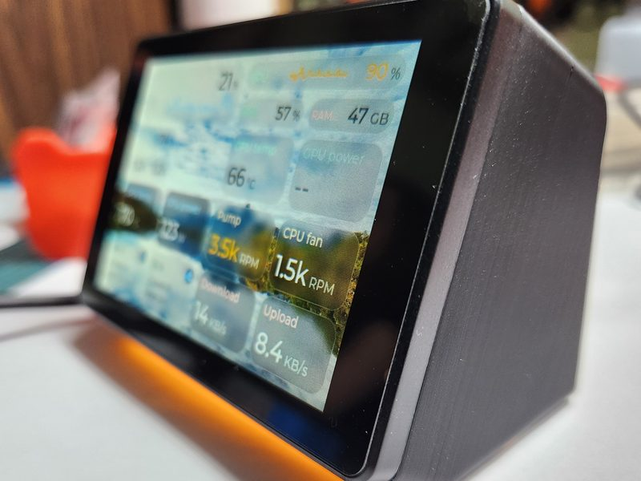 | 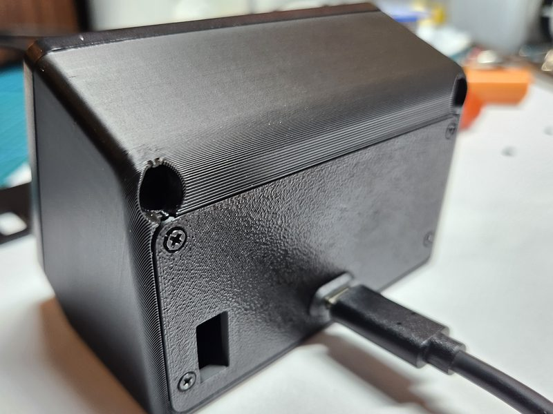 |

Optional: a single-colour status LED on a free GPIO ([wiring](GUIDE.md#wiring-the-led)), a [vibration motor](GUIDE.md#vibration-motor) for tile taps and a microSD card for wallpapers and brand icons.

## Screenshots

Short video of the original touchdeck in use: [YouTube video by Keralots](https://youtube.com/shorts/eh1_8pJR3-M).

Historical screenshots captured from the device (`/screen_live.bmp`), Glass theme unless noted. Some show retired PC monitoring features.

| | |
|:---:|:---:|
| 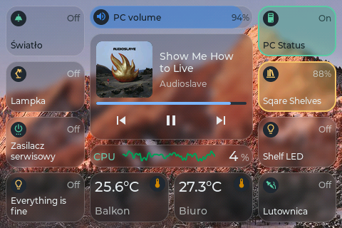 | 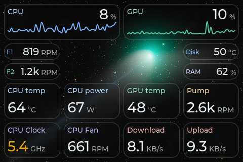 |
| Historical Home Assistant and PC-volume layout | Historical PC statistics (removed) |
| 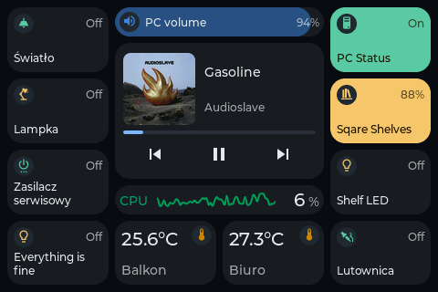 | 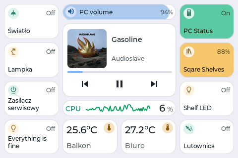 |
| Midnight theme | Daylight theme |
| 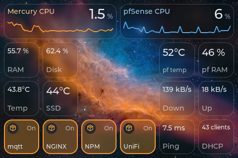 | 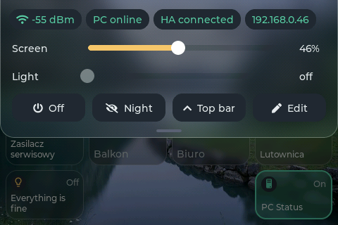 |
| Home lab: Proxmox and pfSense | Quick panel |

## Animations

Recorded frame by frame from the display. Pick a set under **Display > Animations** (Classic, Calm, Water, Glass, Heavy, or Custom to choose each effect).

| | |
|:---:|:---:|
| 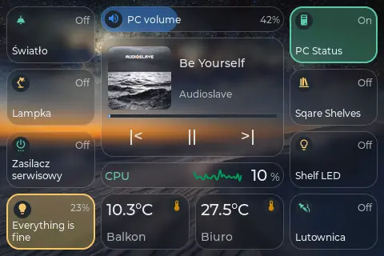 | 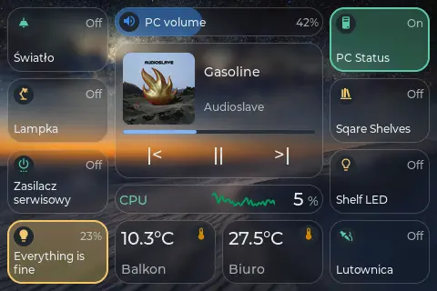 |
| Calm | Water |
| 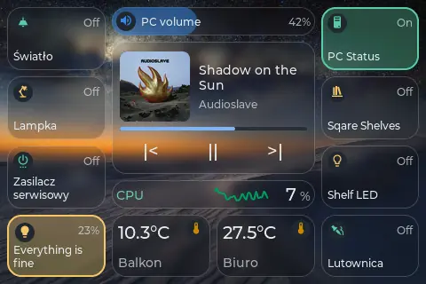 | 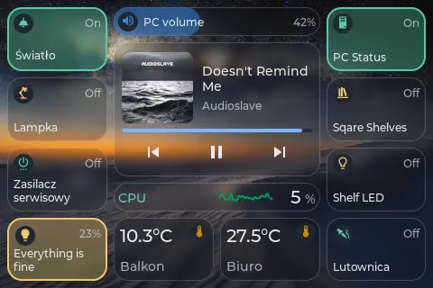 |
| Glass | Heavy |

## What it does

- **Pages of tiles** up to 6x4, sized in half-cell steps, stacked into columns: swipe sideways between columns, up and down within one. [More](GUIDE.md#pages-and-tiles)
- **Home Assistant:** switches, sliders, scenes and scripts, sensors with history charts and warning thresholds, a detail card on long press. Material Design Icons, plus optional [brand icons](GUIDE.md#brand-icons).
- **Home Assistant media controls:** choose a `media_player.*` entity and control playback and volume directly, without a separate PC app.
- **HTTP buttons and sensors** for LAN devices without Home Assistant (Tasmota, Node-RED, your own projects). [Buttons](GUIDE.md#http-buttons), [sensors](GUIDE.md#http-sensors)
- **Conditional tiles and pages:** shown only while a Home Assistant entity is in a chosen state. [More](GUIDE.md#conditional-tiles)
- **Themes:** Midnight, Daylight and Glass over your own pictures or daily Windows Spotlight wallpapers, per-tile colours and icon styles. [Wallpapers](GUIDE.md#wallpapers-and-microsd)
- **Screen sleep** on Home Assistant presence, night schedules for the backlight and the status LED. [More](GUIDE.md#screen-sleep)
- **MQTT discovery:** the deck shows up in Home Assistant with its screen, page, night mode and a message toast. [More](GUIDE.md#mqtt-home-assistant-discovery)
- **Edit on the device:** long press an empty spot to move, resize, add or remove tiles. A quick panel from the top edge has brightness, night mode and link status.

## Getting started

1. Build and install a tactula firmware variant from [the build guide](GUIDE.md#building-from-source).
2. Set up WiFi over USB in the same tab, or join the device's **`tactula-XXXX`** network (password `touchdeck1234`, setup page at `http://192.168.4.1`).
3. Open the device IP, connect [Home Assistant](GUIDE.md#home-assistant) and build your pages.

Updating an existing tactula device: upload the matching `tactula-<version>-ota.bin` build via **Maintenance > Firmware update**. The `without_bambu` and `with_bambu` variants share the same functionality except the optional Bambu P1S/AMS integration. See [GUIDE.md](GUIDE.md#building-from-source).

## Credits and upstream attribution

**Original project:** [TouchDeck](https://github.com/Keralots/TouchDeck) by **[Rafał Stolarek (Keralots)](https://github.com/Keralots)**. tactula is derived from his code and remains licensed under the original MIT licence; see [LICENSE](LICENSE). Credit for the original design, firmware and groundwork belongs to him. The tactula name, artwork, additional functionality and portal theme are modifications in this fork, not a claim of original authorship of the underlying project.

Built on [LVGL](https://lvgl.io/), [ArduinoJson](https://github.com/bblanchon/ArduinoJson), [arduinoWebSockets](https://github.com/Links2004/arduinoWebSockets), [GFX Library for Arduino](https://github.com/moononournation/Arduino_GFX) (AXS15231B init table) and [Improv WiFi](https://www.improv-wifi.com/) (vendored under `lib/ImprovWiFi`). Fonts: Montserrat (SIL OFL 1.1) with the LVGL symbol set (Font Awesome Free); icons: Material Design Icons, installed on the device by the user.

## License

MIT, see [LICENSE](LICENSE). The vendored Improv WiFi library keeps its own MIT license in `lib/ImprovWiFi/LICENSE`.

## Combined Met Office weather for the touchscreen

Home Assistant's default `weather.met_office_hove` entity contains the condition, temperature, humidity, dew point, pressure, visibility, UV and wind. However, some useful Met Office readings are separate entities: apparent ("feels like") temperature, wind gust and probability of precipitation. The supplied **Template Weather** example combines them into one `weather.*` entity that TouchDeck can display without provider-specific code.

1. Copy the weather block in [examples/met_office_hove_weather.yaml](examples/met_office_hove_weather.yaml) into your Home Assistant `configuration.yaml` under the existing top-level `template:` list (if you already have `template:`, **do not add a second top-level key**). The file is an example, not a complete replacement configuration.
2. Validate your Home Assistant YAML configuration, then reload Template Entities in **Developer Tools → YAML** (or **Tools → YAML** on newer Home Assistant). If template reload is unavailable, restart Home Assistant using its UI.
3. Confirm that `weather.touchdeck_hove_weather` exists in **Developer Tools → States** and check its attributes. If Home Assistant assigned a suffix because of an existing entity, use the actual entity ID.
4. In the tactula web portal, edit your weather tile, change its Home Assistant entity to `weather.touchdeck_hove_weather`, and save. You can hide the entity ID under **More options → Show entity ID in popup**.

The combined weather entity includes current-condition values and a custom `precipitation_probability` attribute for the popup. It is **not a forecast proxy**; forecast methods on the original Met Office weather entity are not forwarded. Source entities continue to be owned and updated by the Met Office integration. Missing values are left unavailable rather than silently turned into zero. Units are normalized to °C, km/h, km, and hPa.

For a different weather provider, use the same approach with that provider's entity IDs. The touchscreen reads standard weather attributes and the optional `precipitation_probability` attribute; unavailable observations are omitted.

## Automatic firmware updates

Tactula supports **automatic update checks and optional automatic downloads**, with **physical touchscreen approval required for every installation**.

In the device's web portal, open **Maintenance → Automatic firmware update checks**:

- **Check for updates:** enabled by default. The first check runs about **45 seconds after boot**, then **every six hours** after a successful check. Failed checks retry after **30 minutes**. **Check now** requests an immediate check when the updater is idle.
- **Automatically download verified firmware:** disabled by default. When enabled, discovering a newer version downloads it promptly into the *inactive OTA flash partition*. It verifies the expected board/edition, image byte count, SHA-256 checksum and ESP application image before marking it ready.
- **Show an update icon:** controls the normal top-bar update notification. A successfully staged **automatic** download is quiet and shows an icon (when the top bar is enabled), **not a popup**. Tap the icon to open the confirmation.
- **Download OTA** (manual): downloads and verifies the selected update and **automatically displays** the installation confirmation on the touchscreen once staging finishes, whether or not the optional update icon is enabled. Choosing **Not now** closes it without repeated interruptions.
- **Install and restart** is only available **on the physical touchscreen**. Neither checking nor downloading installs firmware, changes the boot partition, or reboots on its own. No web-based remote install endpoint is provided.

### Where updates come from

The device reads the small HTTPS manifest at `https://firmware.mrsleeps.uk/tactula/releases/current.json` rather than querying the large GitHub Releases API. The website's release mirror obtains published assets from [MrSleeps/tactula GitHub Releases](https://github.com/MrSleeps/tactula/releases), verifies their sizes and SHA-256 digests, then atomically exposes the versioned firmware and manifest. Firmware also verifies HTTPS, the exact model and edition, the canonical OTA path, expected size, and the image hash. A temporary check error does not erase a previously verified update.

The download is **not a separate file on the SD card**. It occupies the ESP32's inactive OTA partition. If a newer version is discovered while an earlier one is waiting for installation, the old image is marked unavailable and the newer verified image **overwrites that same partition** when downloaded (if automatic downloading is enabled). No history of older images accumulates. The installed/running partition is not overwritten by this process.

### Manual OTA and troubleshooting

Use **Maintenance → Firmware update** and upload the matching `firmware.bin` (or the release's `*-ota.bin`) for your edition. **Never upload `firmware.factory.bin` or `*-full.bin` into the OTA page**; those are for initial/full USB flashing. Manual OTA is also how to recover from an update-checker bug without publishing a broken release.

If the device cannot see a published update, confirm that `current.json` and the corresponding `/tactula/releases/vX.Y.Z/*-ota.bin` return HTTP 200 on the firmware website, that the **new** version is higher than the firmware currently installed, and that the firmware edition matches. If download links fail despite being present on disk, check the nginx file permissions and rerun the website mirror. Certificate validation remains mandatory; do not use insecure HTTPS workarounds. The automatic-install option is intentionally unsupported.

